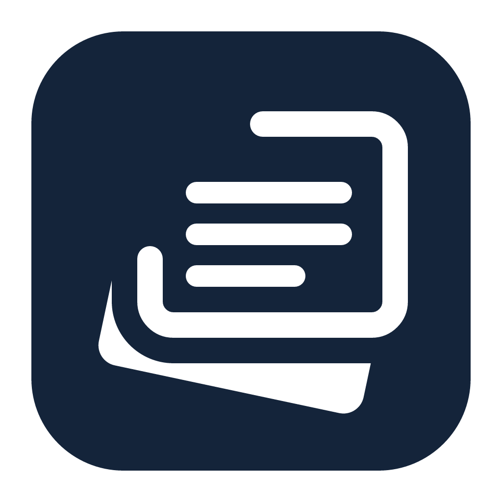

<div align="center">



# JenaNote

**마크다운 문법을 몰라도 쓸 수 있는 macOS용 WYSIWYG 마크다운 메모 앱**

[](https://www.apple.com/macos/)
[](https://swift.org)
[](LICENSE)
[](https://github.com/jenalab-com/jena-note/releases/latest)

[다운로드](#설치) · [기능](#주요-기능) · [소스에서 빌드](#소스에서-빌드) · [단축키](#단축키)

</div>

---

## 왜 JenaNote인가

macOS 기본 메모앱(텍스트 편집기, Notes)은 서식을 `.md`로 저장하지 못하고, 전용 마크다운 에디터(Typora, Obsidian)는 기능이 과하거나 `**`, `#` 같은 기호가 화면에 그대로 노출됩니다.

**JenaNote는 그 사이를 메웁니다.** 마크다운 기호를 화면에 드러내지 않고 서식이 적용된 모습 그대로 편집하되(WYSIWYG), 파일은 어디서나 열리는 표준 CommonMark `.md`로 저장합니다. 마크다운을 모르는 사람도 도움말 없이 서식 있는 문서를 만들어 `.md`로 공유할 수 있습니다.

## 주요 기능

- **WYSIWYG 마크다운 편집** — 편집 중 `**`·`#`·`>` 같은 기호 없이 서식이 적용된 상태로 보입니다. 저장하면 표준 `.md`.
- **서식 툴바** — 굵게, 기울임, 제목(H1~H3), 순서 있는/없는 목록, 코드, 인용, 링크.
- **사이드바 폴더 브라우저** — 폴더를 등록하면 `.md` 파일 트리를 재귀로 표시. 클릭하면 현재 창에서 인-플레이스로 문서 교체, FSEvents 기반 실시간 갱신(외부 추가·삭제·이름변경 자동 반영), 등록 폴더는 재시작 후에도 복원.
- **통합 편집 화면** — 읽기·수정 모드 전환 없이 바로 편집합니다. 상단 툴바에서 서식·삽입·검색·책갈피·AI를 사용하고, 보기 설정에서 서체·화면 굵기·배율·줄 간격과 모바일/책 본문 폭을 조절합니다. 페이지·양면 배치를 유지한 채 본문을 수정할 수 있고, 뒤쪽 페이지는 나눠 계산합니다. 방향키는 커서 이동, Page Up/Down·스크롤 제스처는 페이지 이동에 사용합니다. 전체 쪽수의 `…`는 계산 중 표시입니다.
- **CLI 기반 AI 채팅** — 상단 AI 버튼으로 문서별 채팅을 엽니다. 선택한 글을 인식하며 가이드 또는 직접 수정을 받을 수 있고, 본문 수정은 ⌘Z로 복원합니다. AI 사용 중에는 스크롤 편집으로 전환됩니다. 설정에서 Claude Code·Codex·Gemini CLI·Grok CLI를 설치·로그인하고 **재확인**으로 연결을 검사하세요. 재확인은 짧은 AI 요청으로 사용량이 발생할 수 있습니다. 대화는 앱 실행 중 파일별로 유지됩니다. Grok은 기존 설정과 충돌하지 않도록 JenaNote 전용 프로필에서 최초 로그인이 필요합니다.
- **본문 오류 후보 자동 표시** — 입력을 약 0.5초 멈추면 현재 화면의 문장을 Kiwi로 검사하고, 수정 후보 부분에 주황색 물결 점선 밑줄을 표시합니다. 스크롤·페이지 이동 시 새로 보이는 부분도 검사합니다. 한글 조합 중에는 미루며 원문·저장 서식·실행 취소 이력은 바꾸지 않습니다. 누락된 띄어쓰기는 경계의 두 글자에 표시합니다. 후보에 마우스를 올리거나 커서를 두면 수정안과 적용·사전 담기 버튼이 나타납니다. 적용은 해당 후보만 바꾸며 ⌘Z로 복원합니다.
- **내 사전** — 편집 > 내 사전에서 검사에서 제외할 표현을 검색·등록·수정합니다. 사전 담기는 현재 작품을 기본으로 하며, 전체 작품 또는 선택한 여러 작품에 공유할 수 있습니다. 작품 밖 문서는 전체 작품이 기본임을 표시합니다. 저장하면 본문과 선택 검사에 즉시 반영되며, 항목의 검사 제외를 끄면 다시 검사합니다. 사전은 기기에 저장하고 변경 전 파일을 보관합니다.
- **선택 문장 검사** — 문장을 선택하고 툴바의 문장 검사 또는 편집 메뉴의 선택 문장 검사를 실행합니다. Kiwi가 기기 안에서 띄어쓰기·흔한 오타 교정을 제안하며, 원문과 비교한 뒤 적용합니다. ⌘Z로 복원할 수 있습니다. Apple Intelligence 없이 한 번에 최대 500자를 검사하며 작품 요약을 기다리지 않습니다. 처음에는 모델 준비 시간이 필요합니다. 고유명사로 분석된 어절과 줄바꿈·탭을 보존하지만 모든 오류를 검출하지는 않습니다.
- **문서 크기** — 보기 설정에서 A4·A5·ISO/JIS B계열·Letter·Legal 등을 선택하고 상단 가로 치수자로 좌우 본문 여백을 조절합니다. 규격 용지의 전체 크기는 고정됩니다.
- **본문 배경색** — 설정의 UI 탭에서 macOS 색상 선택기로 원하는 바탕색을 고릅니다. 보기 전용으로 원고와 내보내기에는 영향을 주지 않습니다.
- **원고 버전 이력·복원** — 이름 붙인 버전과 자동 이력을 보관하고, 좌우 비교·변경 위치 표시로 차이를 확인합니다. 복원 전 현재 내용을 보관하며 실행 취소가 가능합니다. 일반 이력은 최근 100개, 이름 붙인 버전은 계속 보관합니다. 별도 이미지 파일은 포함하지 않습니다.
- **문서 끝 주석** — 서식 메뉴에서 번호 참조와 설명을 추가·수정·삭제합니다. Markdown 각주 표기로 저장하며 docx·hwpx에서는 번호와 설명을 일반 텍스트로 보존합니다.
- **작품 문맥 자동 준비** — 설정 자료와 집필 폴더를 등록하면 원문 검색을 준비하고, 상세 요약은 백그라운드에서 진행합니다. 전체 요약을 기다리지 않고 채팅할 수 있으며, 최근 질문과 열린 글을 우선 정리합니다. AI는 요청에 필요한 설정과 이전 화 원문을 먼저 찾아 참고하고, 이후 변경된 부분만 갱신합니다. 파일을 수동 요약해서 500KB에 맞출 필요가 없습니다. 준비 중에도 편집할 수 있고, 준비 상태·재시도·기기 내 요약/발췌 개수는 작품 문맥 창에서 확인합니다. 초기 준비는 Foundation Models로 기기 안에서 처리하고 외부 AI 사용량을 쓰지 않습니다(macOS 26 이상, Apple Intelligence 필요). 모델 비지원 또는 요약 실패 시 원문 발췌로 검색을 유지하며, 현재 화보다 뒤의 글은 요청에 포함하지 않습니다.
- **간결한 AI 입력창** — 가이드·직접 수정, 모델 선택, 보내기/중지를 입력창 안에서 사용합니다. Enter는 전송, Shift+Enter는 줄바꿈이며 한글 조합 확정은 전송하지 않습니다. 사용량은 정보 버튼에서 확인합니다.
- **원문 보기** — 본문 영역을 읽기 전용 마크다운 원문으로 전환해 확인하고 복사합니다. 다시 누르면 기존 편집 화면으로 돌아가며, 저장 전 변경사항도 반영합니다. **인라인 코드**는 선택한 글에 코드 서식을 적용하는 별도 버튼입니다.
- **치수자와 좌·우 여백** — 작성화면 상단에 워드식 cm 치수자가 있습니다. 양 끝 핸들을 끌어 페이지 좌·우 여백을 정하면 글 영역이 그만큼 줄고, 양면 배치에서는 페이지마다 치수자가 놓여 한쪽을 끌면 둘이 같이 움직입니다. 핸들을 페이지 바깥으로 끌면 페이지가 넓어지고(책 폭에서), 더블클릭하면 기본으로 돌아옵니다. 폭과 여백은 보기 설정처럼 기억됩니다.
- **상태바 글자수 카운터** — 창 하단에서 실시간 글자수 확인.
- **docx·hwpx 내보내기** — 노트를 Word(`.docx`)·한글(`.hwpx`)로 내보냅니다. 외부 도구·라이브러리 의존성 0, 순수 Swift로 zip+XML을 직접 생성. (원본 `.md`는 건드리지 않는 단방향 내보내기)
- **줄 간격·글자 색상** 조절, 표준 macOS 단축키와 미저장 변경 경고.

## 설치

[최신 릴리스](https://github.com/jenalab-com/jena-note/releases/latest)에서 `JenaNote.dmg`를 내려받아, 열린 창에서 앱을 **Applications** 폴더로 드래그하세요. (macOS 13 Ventura 이상)

### ⚠️ 처음 실행할 때 — "확인되지 않은 개발자" / "손상되었기 때문에 열 수 없습니다"

JenaNote는 Apple Developer 서명·공증을 거치지 않은 무료 앱입니다. 그래서 처음 열 때 macOS Gatekeeper가 막습니다. **앱이 손상된 것이 아니니** 아래 방법 중 하나로 열어주세요.

**방법 1 — 터미널 (가장 확실, 모든 macOS 버전)**

```bash
xattr -dr com.apple.quarantine /Applications/JenaNote.app
```

실행한 뒤 평소처럼 더블클릭하면 열립니다.

**방법 2 — 시스템 설정 (macOS 15 Sequoia 이상)**

앱을 한 번 더블클릭 → 차단 메시지가 뜨면 → **시스템 설정 > 개인정보 보호 및 보안** 으로 이동 → 맨 아래 "JenaNote을(를) 열도록 허용" 옆 **"확인 없이 열기"** 클릭 → 다시 열기.

**방법 3 — 우클릭 열기 (macOS 13~14)**

Finder에서 앱을 **우클릭(또는 Control+클릭) → 열기 → 열기**.

> 한 번만 통과시키면 이후로는 평범하게 더블클릭으로 열립니다.

## 소스에서 빌드

Swift 5.7+와 Xcode가 필요합니다. Kiwi 소스는 `Vendor/Kiwi/source/`에서 직접 확인·수정할 수 있으며, 로컬 XCFramework를 참조합니다. 최초 준비는 CMake 설치 후 `make bootstrap-kiwi`로 수행합니다(모델이 없을 때만 고정 버전·체크섬으로 다운로드). 이후 `make build`와 `make test`는 네트워크 없이 준비 상태를 검사하고 로컬 라이브러리를 사용합니다. 소스 수정 후에는 `make rebuild-kiwi`를 실행하세요. 모델 약 104MB는 앱에 포함되며 실행 중 다운로드는 없습니다. 도구 설치·오프라인 복사·소스 안내는 [Kiwi 개발 안내](Vendor/Kiwi/README.md)를 참고하세요. `swift build`·`swift test` 직접 호출 전에는 `make prepare-kiwi`가 필요합니다.

```bash
git clone https://github.com/jenalab-com/jena-note.git
cd jena-note

make build     # .build/JenaNote.app 빌드
make run       # 빌드 후 즉시 실행
make install   # ~/Applications 에 설치
make dmg       # 배포용 .dmg 생성
make test      # 테스트 실행
make clean     # 빌드 산출물 삭제
```

직접 빌드한 앱은 quarantine 속성이 붙지 않으므로 위의 Gatekeeper 안내가 필요 없습니다.

## 단축키

| 동작 | 단축키 |
| --- | --- |
| 저장 | ⌘S |
| 다른 이름으로 저장 | ⇧⌘S |
| 굵게 | ⌘B |
| 기울임 | ⌘I |
| 링크 | ⌘K |
| 폴더 추가 | ⇧⌘O |
| 사이드바 토글 | ⌥⌘S |
| 실행 취소 / 다시 실행 | ⌘Z / ⇧⌘Z |

## 파일 포맷

- **저장 포맷**: UTF-8 인코딩 CommonMark 호환 `.md` — VSCode·GitHub 등 다른 뷰어에서 동일하게 렌더링됩니다.
- **내부 표현**: `NSAttributedString` ↔ Markdown 직렬화(저장 시)·역직렬화(열기 시).
- **내보내기**: `.docx`(OOXML)·`.hwpx`(OWPML)는 단방향. 원본 `.md`는 변경하지 않습니다.

## 프로젝트 구조

```
Resources/
  Info.plist        번들 메타데이터
  Fonts/            읽기 모드 명조 (KoPub 바탕, 앱 번들 동봉)
Sources/
  JenaNote/         실행 진입점 (main.swift)
  JenaNoteKit/
    app/            AppDelegate, 설정, 도움말, 로컬라이제이션
    document/       Markdown 직렬화/역직렬화, 신택스 하이라이트
    editor/         편집기 뷰·윈도우 컨트롤러, 서식 명령, 읽기 모드
    sidebar/        폴더 북마크, FSEvents 감시, 아웃라인 뷰
    statusbar/      하단 상태바 (글자수)
    toolbar/        통합 툴바와 서식 버튼 생성
    export/         docx·hwpx Writer, 문서 IR, zip/XML 직접 생성
Tests/              JenaNoteKit 단위 테스트
docs/               spec, architecture, 개발 로그(devlog)
```

자세한 기획·설계는 [`docs/spec.md`](docs/spec.md)와 [`docs/architecture.md`](docs/architecture.md), 버전별 변경 내역은 [`docs/devlog/`](docs/devlog/)를 참고하세요.

## 라이선스

[MIT](LICENSE) © 2026 JenaLab

### 동봉 글꼴

통합 편집 화면의 명조 본문에 **KoPub 바탕체**(Medium·Bold)를 앱 번들에 동봉합니다.
KoPub 서체는 한국출판인회의가 제작·배포하는 무료 글꼴로, 저작권은 한국출판인회의에 있습니다.
이용 조건 전문은 배포처 [kopus.org](https://www.kopus.org/biz/electronic/font/)에서 확인하세요.
